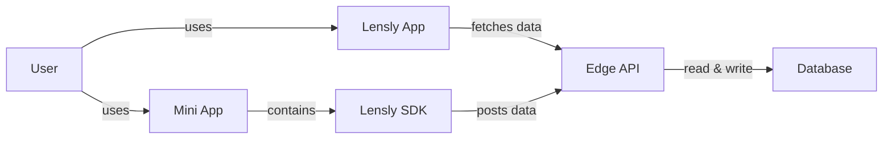

# Lensly

**Lensly is the Analytics Hub for Farcaster Applications.** It captures application context, builds comprehensive user profiles, and ships real-time insights about the entire Mini App ecosystem.

## Executive Summary

- **Problem**: Mini Apps lack drop-in analytics that understand Farcaster-native data.
- **Solution**: Lensly SDK collects deep Farcaster Application usage metrics and conveniently surfaces them in a user-facing dashboard.
- **Impact**: Developers embed one provider, founders open a dashboard, judges see live data and user growth.

Check it out [here](https://farcaster.xyz/~/mini-apps/launch?domain=lensly.seraphim.zone)!

## Product Overview

Lensly is an analytics platform for Farcaster applications in the Base ecosystem providing developers with rich usage metrics and customer profiling.

More information can be found in the [product documentation](./docs/product.md).

## Engineering Overview

The diagarm below provides a simplified overview about the key components of the analytics platform:


Lensly uses a modern techstack optimal for performance and maintainabiltiy across backend, frontend, orchestration, and tooling.

| Component     | Technology                                                 |
| ------------- | ---------------------------------------------------------- |
| Lensly App    | Typescript; Next.js; React.js; Tailwind; ShadCN; HTML, CSS |
| Lensly SDK    | Typescript;                                                |
| Edge API      | Hasura; Caddy;                                             |
| Database      | Postgres;                                                  |
| Orchestration | Docker; Vercel, GitHub                                     |
| Toolings      | Husky; Mise; EsLint; CommitLint, GitHub Action, NPM        |

For more information, check out our [engineering documentation](./docs/engineering.md).

## Quick Start

Install required dependencies:
```bash
# You might have to authenticate to GitHub Packages via NODE_AUTH_TOKEN
npm install @sen-com/lensly
```

Integrate the lensly sdk in your layout:
```typescript
import { AnalyticsProvider } from '@sen-com/lensly';

export function Root({ children }: { children: React.ReactNode }) {
  return (
    <AnalyticsProvider miniappId="demo-app">
      {children}
    </AnalyticsProvider>
  );
}
```

For more information check out our [integration guide](./docs/docs/developer-guide.md).

## Repository Structure

- [Lensly App](./app/): contains the lensly app.
- [Lensly SDK](./packages/lensly/): contains the lensly sdk package.
- [Infra](./infra/): contains lensly infrastructure.
- [Docs](./docs/): features product, engineering, guides, and design documentation.
  
## Important Links

- [Demo](https://youtube.com/shorts/l37PzlkKhU0)
- [Website](https://lensly.seraphim.zone)
- [Mini App](https://farcaster.xyz/~/mini-apps/launch?domain=lensly.seraphim.zone)

---

All Rights Reserved!
