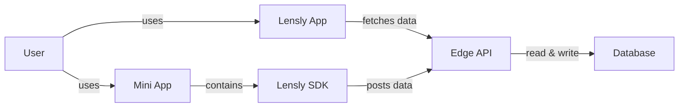
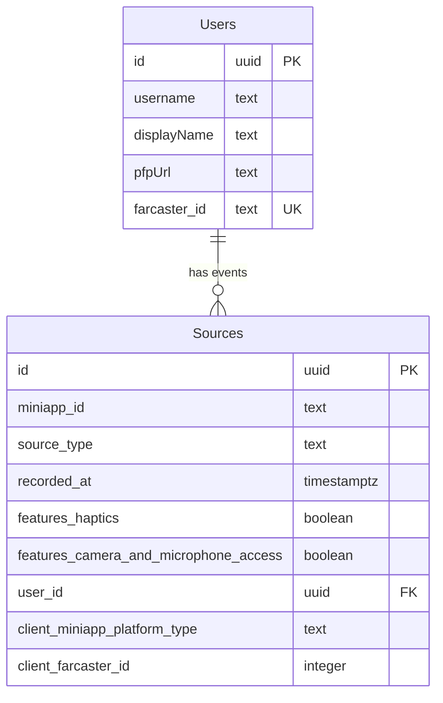

# Engineering Documentation

## Table of Contents

- [System Architecture](#system-architecture)
- [Requirements](#requirements)
- [Tech Stack](#tech-stack)
- [Database](#database)
  - [Entity Relations Diagram](#entity-relations-diagram)

## System Architecture

## Requirements

- The lensly sdk shall be compatible with farcaster apps.
- The lensly sdk shall post context data to the database.
- The database shall be able to receive and store all contet data of the sdk.
- The edge api shall cache requests by the dashboard.
- The edge api shall fetch app context from the database.
- The edge api shall expose get and post endpoints to the lensly app
- The lensly app shall be accessible via Web.
- The lensly app shall be accessible via Farcaster.
- The lensly app shall be accessible via Base.
- The lensly app shall be usable on all common devices.
- The lensly app shall feature a search bar for mini app and farcaster ids.
- The lensly app shall provide metrics about farcaster mini apps and users.

## Tech Stack

| Component     | Technology                                                 |
| ------------- | ---------------------------------------------------------- |
| Lensly App    | Typescript; Next.js; React.js; Tailwind; ShadCN; HTML, CSS |
| Lensly SDK    | Typescript;                                                |
| Edge API      | Hasura; Caddy;                                             |
| Database      | Postgres;                                                  |
| Orchestration | Docker; Vercel, GitHub                                     |
| Toolings      | Husky; Mise; EsLint; CommitLint, GitHub Action, NPM        |

## Database

### Entity Relations Diagram

The Entity Relations Diagram below is normalized to 3NF.

