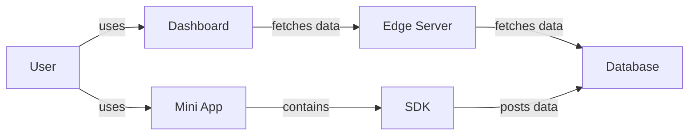
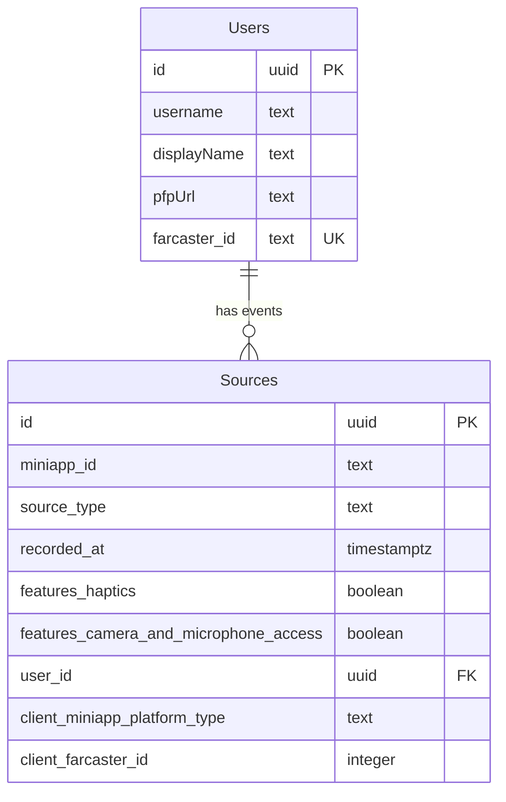

# Engineering Documentation

## Table of Contents

- [System Architecture](#system-architecture)
- [Requirements](#requirements)
- [Tech Stack](#tech-stack)
- [Database](#database)
  - [Entity Relations Diagram](#entity-relations-diagram)

## System Architecture

## Requirements

- The SDK shall be compatible with mini apps.
- The SDK shall post context data to the database.
- The database shall be able to receive and store all contet data of the sdk.
- The edge server shall cache requests by the dashboard.
- The edge server shall fetch app context from the database.
- The dashboard shall be accessible via Web.
- The dashboard shall be accessible via Farcaster.
- The dashboards shall be usable on all common devices.
- The dashboard shall feature a search bar for farcaster ids.

## Tech Stack

| Component     | Technology                                               |
| ------------- | -------------------------------------------------------- |
| Dashboard     | Typescript; Next.js; React.js; Tailwind; Vercel; ShadCN; |
| Edge Server   | Hasura; Caddy;                                           |
| Database      | Postgres;                                                |
| SDK           | Typescript;                                              |
| MiniApp       | Typescript;                                              |
| Orchestration | Docker;                                                  |

## Database

### Entity Relations Diagram

The Entity Relations Diagram below is normalized to 3NF.

