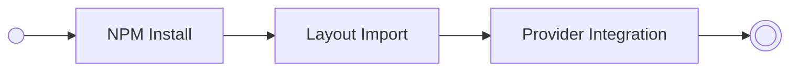
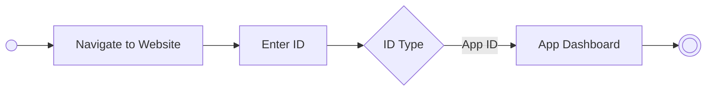

# Product Documentation

## Table of Contents

- [Brainstorming](#brainstorming)
- [Features](#features)
- [Archetypes](#archetypes)
- [User Flows](#user-flows)
  - [Developer](#developer)
  - [User](#user)
- [User Stories](#user-flows)

## Brainstorming

- Idea: Analytics tool for farcaster
- What's the focus: Miniapp analytics / user analytics

## Features

- An analytics sdk for mini apps.
- A dashboard that shows user mini app usage by source over time.

## Archetypes

- A farcastrer miniapp developer that integrates our sdk.
- A farcaster user or developer that wants to see the impact of his account or application.

## User Flows

### Developer

### User

## User Stories

- As a user I want to enter an application id so that I can learn more about the application.
- As a user I want to see a source breakdown betweeen all sources so that I can have a high level overview about the app user sources.
- As a user I want to see the total number of users by source plotted over time so that i can see historic patterns.
- As a developer I want to integrate the sdk into my mini app so that I can access the functionality of the analytics platform.
- As a user I want to be informed that the app I am searching for has no data so that I do not waste my time wondering why there is not data.
- Tracking: Nutzerstandort, Nutzerverhalten, Aktivitäten, Kaufverhalten, Anzahl der Interaktionen je Nutzer, Klassifiaktion der Interatkionen, (datenkrake)

